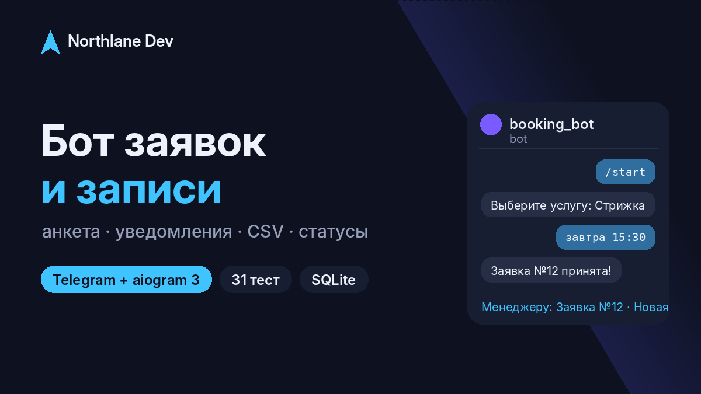

# Leads & Booking Bot — Telegram-бот для приёма заявок и записи



> **EN:** A Telegram bot that collects booking requests (service → name → phone → time slot → comment), checks slot availability, notifies managers instantly and lets them change status and export everything to CSV. Python 3.11+, aiogram 3, SQLite. Core logic is covered by 31 unit tests.

Бот принимает заявки от клиентов, проверяет, свободно ли время, и сразу присылает карточку заявки менеджерам. Подходит для салонов, студий, ремонта, консультаций — любого бизнеса, который записывает клиентов.

## Что умеет

**Для клиента**
- Выбор услуги кнопками
- Пошаговая анкета: имя → телефон (кнопкой «Отправить номер» или вручную) → дата и время → комментарий
- Понимает «завтра 15:30», «25.11 14:00», «сегодня 18:00»; не даёт записаться на прошедшее или нерабочее время
- Не даёт занять время, которое уже занято
- Подтверждение заявки перед отправкой

**Для менеджера**
- Мгновенное уведомление о новой заявке с кнопками статуса: «В работе», «Выполнена», «Отменена»
- `/leads` — последние заявки, `/new` — только новые
- `/export` — выгрузка всех заявок в CSV (открывается в Excel без «кракозябр»)
- Несколько администраторов

## Как устроено

```
app/
  validators.py   # телефоны (+7/8/международные), имена, разбор даты и времени
  storage.py      # SQLite: заявки, статусы, занятые слоты, экспорт CSV
  texts.py        # все тексты бота и форматирование карточек (с экранированием HTML)
  keyboards.py    # inline- и reply-клавиатуры, CallbackData
  handlers/
    user.py       # анкета клиента на FSM (конечный автомат)
    admin.py      # команды и кнопки менеджера, фильтр IsAdmin
  config.py       # настройки из .env
  main.py         # точка входа
tests/
  test_core.py    # 31 тест: валидация, хранилище, экспорт, экранирование
```

Логика (валидация, хранилище, тексты) отделена от Telegram, поэтому её легко тестировать и переносить — например, в бота для MAX или на веб-форму.

## Запуск

```bash
python -m venv .venv && source .venv/bin/activate   # Windows: .venv\Scripts\activate
pip install -r requirements.txt
cp .env.example .env        # впишите токен от @BotFather и свой Telegram ID
python -m app.main
```

Тесты:

```bash
pip install pytest
pytest -q
```

## Настройки (.env)

| Переменная | Пример | Описание |
|---|---|---|
| `BOT_TOKEN` | `123456:ABC...` | токен от @BotFather |
| `ADMIN_IDS` | `111111,222222` | Telegram ID менеджеров через запятую |
| `SERVICES` | `Стрижка,Маникюр` | список услуг для кнопок |
| `WORK_START` / `WORK_END` | `9` / `20` | рабочие часы для записи |
| `DB_PATH` | `leads.db` | путь к базе SQLite |

## Что можно добавить под ваш бизнес

Выгрузка в Google Таблицы, напоминание клиенту за день до визита, выбор мастера, интеграция с CRM (amoCRM, Bitrix24), оплата предоплаты, перенос на PostgreSQL и Docker.

---
Демо-проект из портфолио **Northlane Dev** · лицензия MIT
